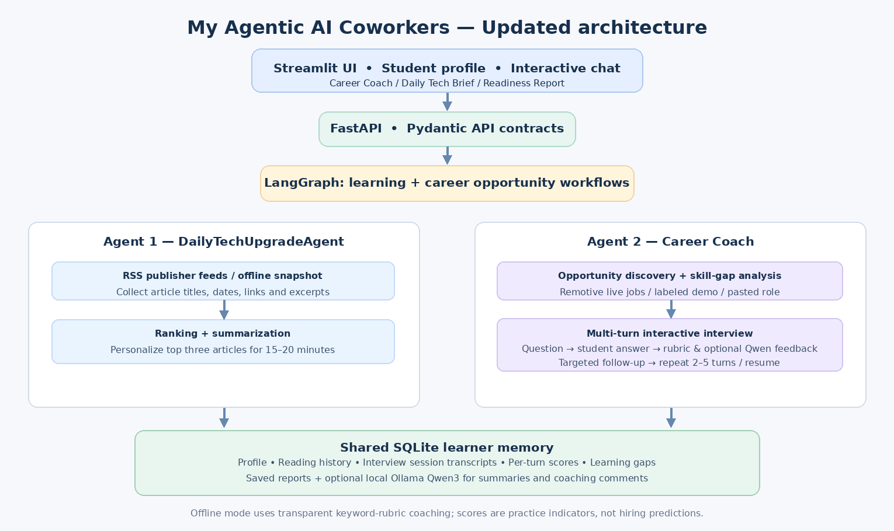

# Agentic AI Coworkers — Design, Development & Evaluation

**Student Name:** Arti Ramesh Nalawade
**Student Id:** 020757113
**Scope:** Functional starter prototype with explicit demo data and optional live sources.  
**Frameworks:** Python, FastAPI, Streamlit, LangGraph, SQLite, optional Ollama (Qwen3 1.7B).

## 1. Goals and expected outcomes

### Agent 1 — DailyTechUpgradeAgent

**Goal:** Help a technical learner discover three high-quality articles daily, read for 15–20 minutes, and connect each reading to stated learning interests and career direction.

**Inputs:** Profile interests, target role, live technical publisher RSS feeds (or an explicitly labeled, dated offline snapshot).  
**Outputs:** Three title/date/source/URL entries, short *RSS-excerpt-based* summaries, learning relevance, 6-minute slots, downloadable daily brief.

### Agent 2 — nextLevelPersonalCoachForCareerLevel

**Goal:** Help students plan career growth by examining opportunities, practicing interviews and tracking improvements over time.

**Inputs:** Profile skills/goal, live remote job descriptions or pasted roles, questions and answers.  
**Outputs:** Opportunity shortlist, keyword-based skill gaps, a 2–5-turn technical/coding/scenario interview with adaptive follow-up questions, per-turn rubric feedback, saved transcripts and career-readiness report.

## 2. Architecture

- **Frontend:** Streamlit provides four screens (daily articles, career coach, readiness report, profile).
- **API:** FastAPI exposes JSON endpoints documented in Swagger at `/docs`.
- **Orchestration:** Two explicit LangGraph DAGs. The daily graph discovers feeds then ranks and composes a brief. The career graph searches opportunities, analyzes skill gaps, selects a question and assembles a preparation report. A FastAPI-driven bounded interview state machine handles persistent multi-turn answer/feedback/follow-up exchanges; this interactive loop is outside the LangGraph DAG.
- **Data sources:** Trusted publisher RSS feeds (AWS ML, Microsoft Research, Google DeepMind/Google AI, Hugging Face); optional Remotive remote-jobs API; manually pasted role descriptions.
- **Memory:** Local SQLite persists profile, read-article history, daily brief snapshots and previous interview answers/results. Learning recommendations consider interests, recent missed rubric concepts, and already-read URLs. There is no authentication or distributed memory.
- **LLM:** Optional local Qwen3 1.7B via Ollama. When unavailable, the system uses clearly labeled excerpt summaries and deterministic practice scoring rather than fake LLM output.
- **Validation:** Pydantic contracts, HTTPS URL filters, data-source labels, transparent rubric, error handling and sample/live separation.

## 3. Main workflows

**Daily learning:** Student profile → RSS discovery (or demo input) → deduplicate → relevance rank (interest keyword/title/date score, source diversity) → summarize excerpt → 18-minute learning brief → SQLite snapshot / Markdown download.

**Career coaching:** Student profile → Remotive remote job lookup (or labeled sample opportunities) → compare matching skills → choose technical/coding/scenario topic → start SQLite-backed interview session → ask question → student answer → measure concept coverage → feedback → adapt next question to missing concept (or applied challenge) → repeat 2–5 turns → save complete transcript → readiness report.

## 4. Example output

See `sample_outputs/daily_tech_brief_DEMO.md` and `sample_outputs/career_readiness_DEMO.md` (generated from offline mode; articles are historical, opportunities are fictional, scores are practice-only).

## 5. Evaluation plan

| Metric | How to measure | Success criterion for class demo |
|---|---|---|
| Daily selection count | Count articles | Exactly 3 when data available |
| Citation completeness | Title, date, source, HTTPS URL populated | 100% of real RSS-selected items |
| Personalization | Change profile interests, compare ranking/relevance | Relevance explanation changes; ranking can change |
| Source honesty | Review demo/live labels and excerpt-limited claims | No fictitious job presented as a live listing, and static articles labeled |
| Career interactivity | Follow-up responds to missing concept | 3 completed Q&A turns with adaptive prompt |
| Session persistence | Resume after restart or refresh | Same session ID, transcript and next question returned |
| Persistent memory | Restart app; inspect readiness report | Previous practice attempt remains |
| Reliability | Run pytest offline; test source failures | Tests pass, failures reported clearly |
| Career-progress metric | Average rubric score over answers | Available and updated after each practice attempt |

**Evaluation limitations:** Matching based on keywords can be shallow. Interview grading is a practice rubric, not robust semantic assessment. Live APIs can return no results, and Remotive job data may be delayed or geographically restricted. Source excerpt summaries cannot substitute for full-paper reviews. To strengthen the system, add answer calibration with human reference grading, source article fetch with copyright-aware extraction, research/internship sources, automatic scheduling, learner feedback, and multi-user authentication.

## 6. Agentic behavior and safety

The workflows are bounded, tool-using and stateful rather than two unrestricted chat prompts. Both have a clearly defined goal, tool/data acquisition, decision stages and persisted progress. The product does **not** independently run every morning unless the separate CLI is scheduled. The app explicitly distinguishes live observations from teaching examples. Personal answers live in a local database and should not be uploaded publicly.

## 7. Working prototype demonstration

1. Start FastAPI and Streamlit from the README.
2. Edit the profile to target AI/ML engineering.
3. Show the daily top 3 demo and then live RSS if internet works.
4. Show opportunities, start a 3-question RAG interview, submit a partial answer, show the targeted follow-up and complete the session.
5. Show that Career Readiness Report reflects the saved answer.
6. Show the architecture diagram and `pytest -q` results.

## 8. Scope and next improvements

**Implemented:** Two LangGraph workflows; working UI/API; live RSS and job discovery; sample modes; local profile and answer memory; deterministic concept-coverage scoring; persistent adaptive multi-turn sessions; optional Ollama text generation; downloadable Markdown results.

**Not yet implemented:** Fully automated background delivery; full-text article understanding; live dedicated research/internship/startup listing integrations; robust semantic grading and fully generative multi-turn question selection; user authentication; production security and monitoring.
